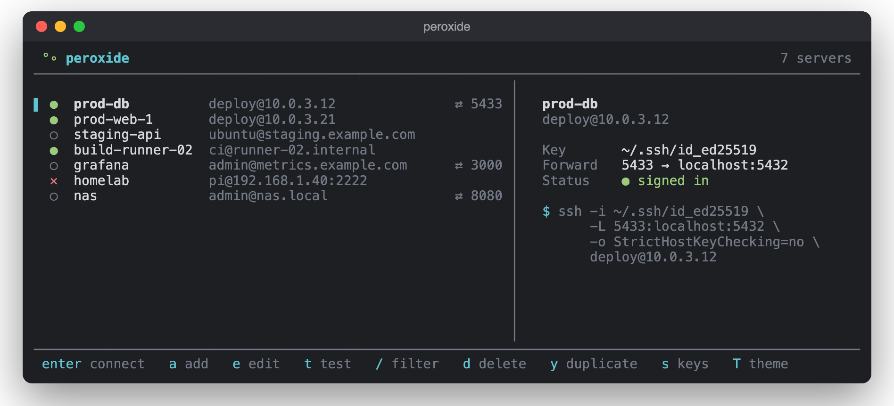

# Peroxide

A terminal-based SSH connection manager written in Rust, featuring an intuitive TUI interface for managing and connecting to your SSH servers.




## Features

- 🔑 Password, SSH key and ssh-agent authentication
- 📁 Automatic SSH key discovery from `.ssh` directory
- 💾 Persistent storage of connections and settings
- 🔄 Connection testing functionality
- 🔍 Easy navigation with keyboard shortcuts
- 📝 Edit, duplicate, and delete connections
- 🎨 Terminal UI with built-in color themes

## Installation

### Arch User Repository

#### peroxide-ssh-manager-bin

[](https://aur.archlinux.org/packages/peroxide-ssh-manager-bin)

#### peroxide-ssh-manager-git

[](https://aur.archlinux.org/packages/peroxide-ssh-manager-git)


### From Release (Mac Arm64 / Linux x64)

Ensure you have ```sshpass``` installed from your package manager (brew/apt/pacman...etc).

Download the latest release from the [Releases](https://github.com/0xgingi/peroxide/releases) page.

```bash
cd $HOME/Downloads
sudo cp peroxide /usr/local/bin/
```

### From Source

Make sure you have Rust installed ([rustup](https://rustup.rs/)) and sshpass, then:

```bash
git clone https://github.com/0xgingi/peroxide.git
cd peroxide
cargo build --release
sudo cp target/release/peroxide /usr/local/bin/
```

## Usage

Simply run `peroxide` in your terminal to launch the application.

### Key Bindings

- `Enter` / `c` - Connect to selected server
- `t` - Test selected connection
- `↑/↓` or `j/k` - Move selection
- `Shift+↑/↓` or `J/K` - Reorder connections
- `/` - Filter connections
- `a` - Add new connection
- `e` - Edit selected connection
- `y` - Duplicate selected connection
- `d` - Delete selected connection
- `s` - Manage SSH keys
- `T` - Pick a color theme
- `q` - Quit

In the add/edit form, `Tab`/`↓` and `Shift+Tab`/`↑` move between fields, `←/→` picks an SSH key, `Enter` saves and `Esc` cancels.

### Themes

Press `T` to pick a theme; moving through the list previews it live and `Enter` keeps it. The default, **Terminal**, uses your terminal's own colors. The others are Catppuccin Mocha, Catppuccin Latte, Tokyo Night, Gruvbox Dark, Nord, Dracula, Rosé Pine and Peroxide. They need a terminal with 24-bit color, which most modern terminals have.

## Configuration

Peroxide automatically stores its configuration in:
- Linux: `~/.config/peroxide/`
- macOS: `~/Library/Application Support/peroxide/`
- Windows: `%APPDATA%\peroxide\`

## Notes

- Windows has not been tested
